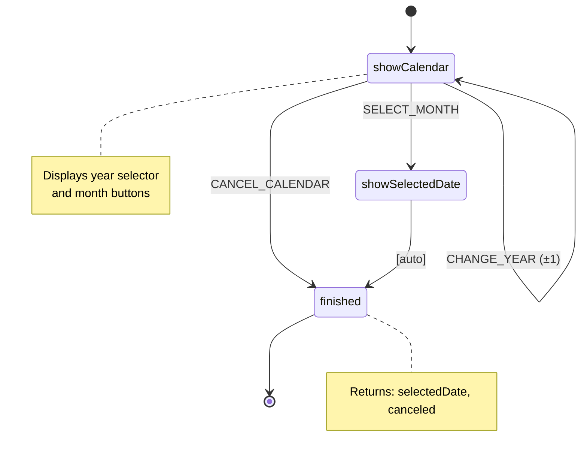
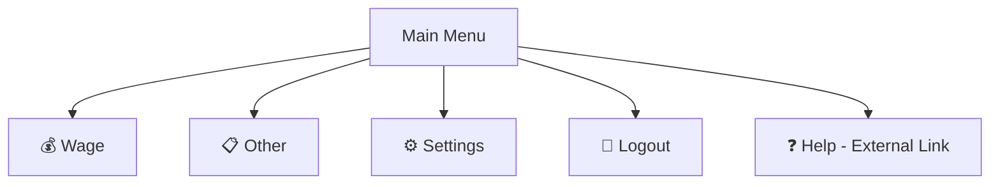
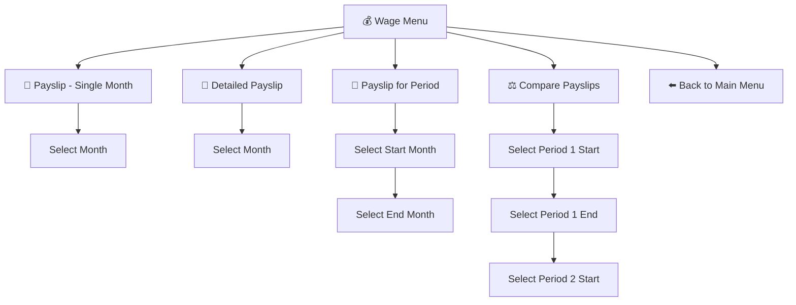
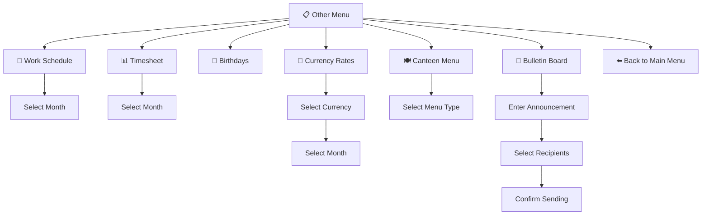
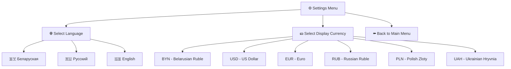
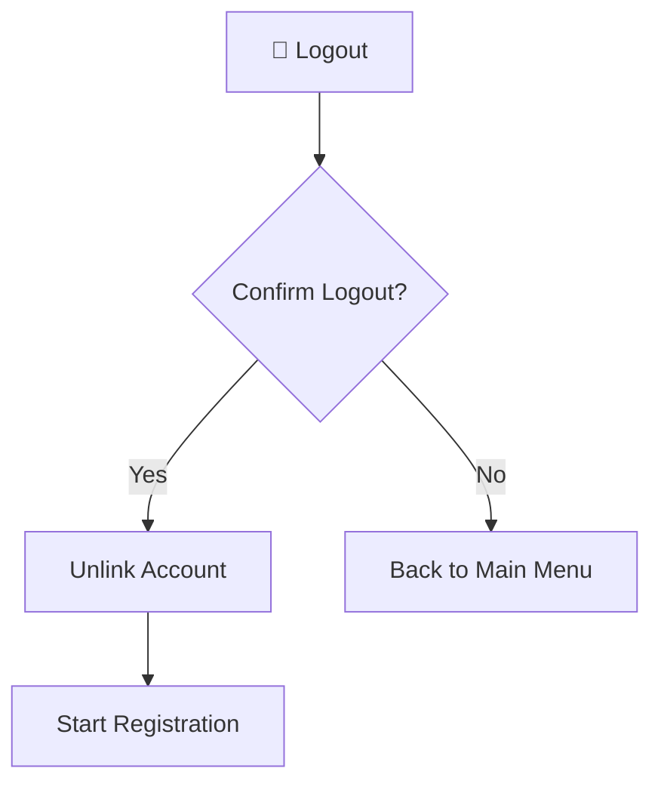
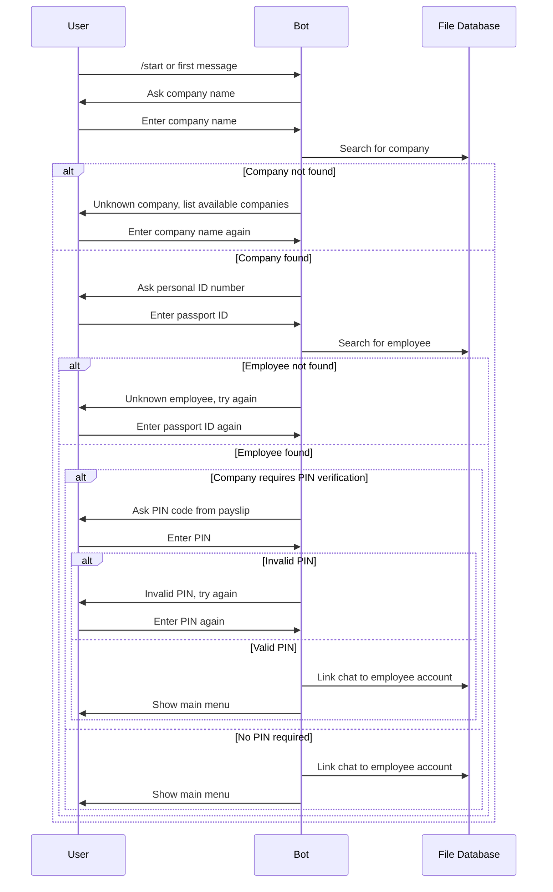

# Zarobak Bot State Flow Diagram

This document describes the navigation flow and state transitions in the Zarobak Bot using Mermaid diagrams.

## Overview

The bot uses XState library to manage conversation state. There are two main state machines:
1. **Bot Machine** - Main state machine handling user registration, menu navigation, and features
2. **Calendar Machine** - Sub-machine for date selection (invoked by various features)

---

## Main Bot State Machine

```mermaid
stateDiagram-v2
    [*] --> init

    %% Initial state transitions
    init --> registerCompany : START
    init --> mainMenu : MAIN_MENU (registered user)

    %% Registration flow
    state registerCompany {
        [*] --> askCompanyName
        askCompanyName --> askCompanyName : ENTER_TEXT [company not found]
    }
    registerCompany --> registerEmployee : ENTER_TEXT [company found]

    state registerEmployee {
        [*] --> askPersonalNumber
        askPersonalNumber --> askPersonalNumber : ENTER_TEXT [employee not found]
        askPersonalNumber --> verification : ENTER_TEXT [employee found]
        
        verification --> checkPIN : [isProtected]
        verification --> mainMenu : [not protected]
        
        checkPIN --> checkPIN : ENTER_TEXT [invalid PIN]
        checkPIN --> mainMenu : ENTER_TEXT [valid PIN]
    }

    %% Main Menu
    state mainMenu {
        [*] --> showMenu
    }
    mainMenu --> wage : .wage
    mainMenu --> other : .other
    mainMenu --> settings : .settings
    mainMenu --> logout : .logout

    %% Wage submenu
    state wage {
        [*] --> showWageMenu
    }
    wage --> payslip : .payslip
    wage --> latestPayslip : .latestPayslip
    wage --> detailedPayslip : .detailedPayslip
    wage --> payslipForPeriod : .payslipForPeriod
    wage --> comparePayslip : .comparePayslip
    wage --> mainMenu : .cancelWage

    %% Payslip flows
    state payslip {
        [*] --> ps_enterDate
        ps_enterDate --> ps_showPayslip : SELECT_MONTH
        ps_enterDate --> mainMenu : CANCEL_CALENDAR
    }
    payslip --> mainMenu : [auto]

    latestPayslip --> mainMenu : [auto]

    state detailedPayslip {
        [*] --> dp_enterDate
        dp_enterDate --> dp_showDetailedPayslip : SELECT_MONTH
        dp_enterDate --> mainMenu : CANCEL_CALENDAR
    }
    detailedPayslip --> mainMenu : [auto]

    state payslipForPeriod {
        [*] --> pfp_enterDateBegin
        pfp_enterDateBegin --> pfp_enterDateEnd : SELECT_MONTH
        pfp_enterDateBegin --> mainMenu : CANCEL_CALENDAR
        pfp_enterDateEnd --> pfp_showPayslip : SELECT_MONTH
        pfp_enterDateEnd --> mainMenu : CANCEL_CALENDAR
    }
    payslipForPeriod --> mainMenu : [auto]

    state comparePayslip {
        [*] --> cp_enterDateBegin
        cp_enterDateBegin --> cp_enterDateEnd : SELECT_MONTH
        cp_enterDateBegin --> mainMenu : CANCEL_CALENDAR
        cp_enterDateEnd --> cp_enterDateBegin2 : SELECT_MONTH
        cp_enterDateEnd --> mainMenu : CANCEL_CALENDAR
        cp_enterDateBegin2 --> cp_showCompare : SELECT_MONTH
        cp_enterDateBegin2 --> mainMenu : CANCEL_CALENDAR
    }
    comparePayslip --> mainMenu : [auto]

    %% Other submenu
    state other {
        [*] --> showOtherMenu
    }
    other --> mainMenu : .cancelOther
    other --> showBirthdays : .birthdays
    other --> sendAnnouncement : .billboard
    other --> showCurrencyRates : .rates
    other --> showTable : .table
    other --> showSchedule : .schedule
    other --> showCanteenMenu : .canteenmenu

    showBirthdays --> mainMenu : [auto]

    state showCanteenMenu {
        [*] --> cm_checkData
        cm_checkData --> cm_selectMenu : [hasData]
        cm_checkData --> cm_noData : [noData]
        cm_noData --> mainMenu : [auto]
        cm_selectMenu --> cm_showText : SELECT_CANTEEN_MENU
    }
    showCanteenMenu --> mainMenu : .cancelSettings
    showCanteenMenu --> mainMenu : [auto after display]

    state showCurrencyRates {
        [*] --> cr_selectCurrency
        cr_selectCurrency --> cr_selectMonth : SELECT_CURRENCY
        cr_selectMonth --> cr_showRates : SELECT_MONTH
        cr_selectMonth --> mainMenu : CANCEL_CALENDAR
    }
    showCurrencyRates --> mainMenu : .cancelRates
    showCurrencyRates --> mainMenu : [auto after display]

    state showTable {
        [*] --> tbl_enterDate
        tbl_enterDate --> tbl_showTable : SELECT_MONTH
        tbl_enterDate --> mainMenu : CANCEL_CALENDAR
    }
    showTable --> mainMenu : [auto]

    state showSchedule {
        [*] --> sch_enterDate
        sch_enterDate --> sch_showSchedule : SELECT_MONTH
        sch_enterDate --> mainMenu : CANCEL_CALENDAR
    }
    showSchedule --> mainMenu : [auto]

    state sendAnnouncement {
        [*] --> ann_enterText
        ann_enterText --> ann_sendMenu : ENTER_TEXT
        ann_sendMenu --> ann_confirm : .sendToDepartment / .sendToEnterprise / .sendToAll
        ann_confirm --> ann_sending : .confirmSending
        ann_confirm --> mainMenu : .cancelSending
        ann_sending --> mainMenu : [auto]
    }
    sendAnnouncement --> mainMenu : .cancelEnterAnnouncement
    sendAnnouncement --> mainMenu : .cancelSendAnnouncement

    %% Settings submenu
    state settings {
        [*] --> showSettingsMenu
        showSettingsMenu --> selectLanguage : .selectLanguage
        showSettingsMenu --> selectCurrency : .selectCurrency
        selectLanguage --> showSettingsMenu : [language selected]
        selectLanguage --> showSettingsMenu : .cancelSettings
        selectCurrency --> showSettingsMenu : [currency selected]
        selectCurrency --> showSettingsMenu : .cancelSettings
    }
    settings --> mainMenu : .cancelSettings

    %% Logout
    state logout {
        [*] --> showLogoutMessage
        showLogoutMessage --> confirmedLogout : .confirmLogout
    }
    logout --> mainMenu : .cancelLogout
    confirmedLogout --> [*]
```

---

## Calendar Sub-Machine

The calendar machine is invoked for date selection in various features (payslips, timesheets, schedules, currency rates).

---

## Menu Structure

### Main Menu

### Wage Submenu

### Other Submenu

### Settings Submenu

### Logout Flow

---

## Registration Flow

---

## User Rights and Menu Visibility

Some menu items are conditionally displayed based on user rights:

| Menu Item | Required Right | Default |
|-----------|---------------|---------|
| Work Schedule | `SCHEDULE` | Allowed |
| Timesheet | `TABLE` | Allowed |
| Birthdays | `BIRTHDAYS` | Allowed |
| Canteen Menu | `CANTEEN_MENU` | Allowed |
| Send to Department | `ANN_DEPT` (write) | Allowed |
| Send to Enterprise | `ANN_ENT` (write) | Denied |
| Send to All | `ANN_GLOBAL` (write) | Denied |

---

## Commands Reference

| Command | Description | Transition |
|---------|-------------|------------|
| `.wage` | Open wage submenu | mainMenu → wage |
| `.other` | Open other features submenu | mainMenu → other |
| `.settings` | Open settings submenu | mainMenu → settings |
| `.logout` | Start logout process | mainMenu → logout |
| `.payslip` | Show payslip for month | wage → payslip |
| `.detailedPayslip` | Show detailed payslip | wage → detailedPayslip |
| `.payslipForPeriod` | Show payslip for date range | wage → payslipForPeriod |
| `.comparePayslip` | Compare two periods | wage → comparePayslip |
| `.latestPayslip` | Show latest payslip | wage → latestPayslip |
| `.cancelWage` | Back to main menu | wage → mainMenu |
| `.birthdays` | Show today's birthdays | other → showBirthdays |
| `.billboard` | Send announcement | other → sendAnnouncement |
| `.rates` | Show currency rates | other → showCurrencyRates |
| `.table` | Show timesheet | other → showTable |
| `.schedule` | Show work schedule | other → showSchedule |
| `.canteenmenu` | Show canteen menu | other → showCanteenMenu |
| `.cancelOther` | Back to main menu | other → mainMenu |
| `.selectLanguage` | Change interface language | settings → selectLanguage |
| `.selectCurrency` | Change display currency | settings → selectCurrency |
| `.cancelSettings` | Back to main/settings menu | settings → mainMenu |
| `.confirmLogout` | Confirm account unlink | logout → confirmedLogout |
| `.cancelLogout` | Cancel logout | logout → mainMenu |
